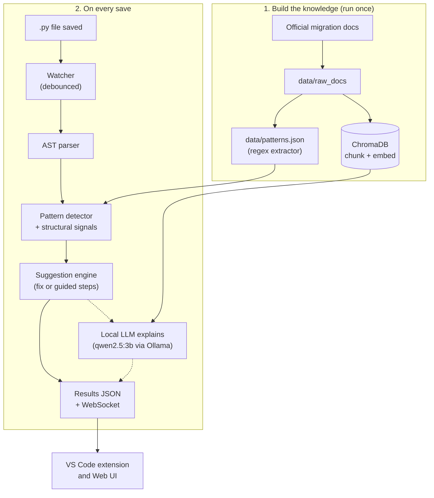

# FrameworkSync

**Catch legacy LangChain, LangGraph and LlamaIndex code the moment you save it, and migrate it safely.**

AI coding assistants and old tutorials keep suggesting APIs that these frameworks have since deprecated
(`create_react_agent`, `AgentExecutor`, `ServiceContext`, `MessageGraph`, ...). FrameworkSync watches your
Python files, flags those patterns with squiggles in VS Code, and either rewrites them for you or tells you
exactly which lines to change by hand. Everything runs locally: no API keys, no code leaves your machine.

## What it does

- **Detects legacy patterns** by parsing your code with Python's `ast` module (your code is never executed).
- **Learns what is deprecated from the official docs.** Migration guides and changelogs are scraped and
  turned into a pattern list (`data/patterns.json`) by deterministic regex rules, not by an LLM.
- **Fixes what is safe to fix automatically** and gives numbered, line-specific steps for the rest.
- **Explains each suggestion** with a local LLM that answers from the scraped docs (RAG over ChromaDB).
  The LLM only explains; it never edits your code.
- **Works where you work:** a VS Code extension (squiggles, hover, Quick Fix, undo), a live web UI, and a
  terminal watcher.

## The 9 migrations

| Legacy pattern | Replacement | Mode |
| --- | --- | --- |
| `create_react_agent` (LangGraph prebuilt) | `create_agent` (`langchain.agents`) | Automatic |
| `AgentExecutor` | removed, the agent is used directly | Automatic |
| `MessageGraph` | `StateGraph(MessagesState)` | Automatic |
| `LLMPredictor` | the LLM itself (`llm.predict(...)`) | Automatic |
| `PromptHelper` | `Settings.context_window` / `Settings.num_output` | Automatic |
| `ServiceContext` | `Settings` | Automatic |
| `AgentRunner` | workflow-based API | Guided steps |
| `AgentWorker` | workflow-based API | Guided steps |
| `QueryPipeline` | `Workflow` | Guided steps |

"Automatic" is applied only when **every** use of the old name in the file has a shape FrameworkSync knows how
to rewrite. Otherwise it falls back to guided steps and tells you why. Beyond these nine, the pattern list built
from the docs (17 entries, for example `MultiServerMCPClient`, `AgentState`, `GPTVectorStoreIndex`) is flagged
with its replacement.

## How it works



Design choices worth knowing:

- **Instant feedback first, LLM second.** The fast result is published immediately; LLM explanations are
  generated by one background worker, cached, and the file's result is re-published as each one arrives.
- **Edits are guarded.** Every edit carries the exact original lines and is refused if the file changed since
  the analysis.
- **Undo is built in.** Before any migration the file must be committed in git (the extension creates a
  checkpoint commit), and `FrameworkSync: Undo migration` restores it.
- **A failed analysis never erases good results.** A syntax error in a half-typed file keeps the last good
  suggestions and only adds an error.
- **One watcher at a time.** A lock file stops two watchers from overwriting each other.

## Requirements

- Python 3.12+ and [uv](https://docs.astral.sh/uv/)
- [Ollama](https://ollama.com/) with `qwen2.5:3b` (about 8 GB RAM is enough, no GPU needed)
- Node.js, only to build and test the VS Code extension
- First ingestion downloads the embedding model `BAAI/bge-small-en-v1.5` (about 130 MB)

## Quick start

```bash
git clone https://github.com/Purvaja11/frameworksync.git
cd frameworksync
uv sync
ollama pull qwen2.5:3b
```

The scraped docs and `patterns.json` are included, so you only need to build the vector index:

```bash
uv run frameworksync ingest      # chunk + embed the docs into ChromaDB (first run downloads the embedder)
```

Then try it on the bundled demo file, which contains all nine legacy patterns:

```bash
uv run frameworksync watch examples
# open examples/legacy_demo.py, save it, and watch the suggestions appear
```

### Commands

| Command | What it does |
| --- | --- |
| `frameworksync scrape` | Download the official migration docs into `data/raw_docs` |
| `frameworksync patterns` | Extract deprecated patterns into `data/patterns.json` |
| `frameworksync ingest` | Chunk and embed the docs into ChromaDB |
| `frameworksync ask` | Ask migration questions in the terminal (answers cite their doc chunks) |
| `frameworksync watch <folder>` | Watch a folder and print results on every save |
| `frameworksync ui <folder>` | Live web UI at http://127.0.0.1:8000 |

To refresh everything from the latest docs: `scrape`, then `patterns`, then `ingest`.

## VS Code extension

```bash
cd vscode-extension
npx @vscode/vsce package
code --install-extension frameworksync-vscode-0.2.1.vsix
```

Open the FrameworkSync project folder in VS Code (or set `frameworksync.projectRoot`) and the extension starts
the watcher itself (from the project's `.venv`, or via `uv`). You get squiggles and Problems entries, hover details, a Quick Fix to apply a
migration, a status-bar counter, and these commands: *Refresh*, *Apply Migration*, *Show log*,
*Restart watcher* and *Undo migration (restore git checkpoint)*.

Settings: `frameworksync.projectRoot`, `frameworksync.resultsPath`, `frameworksync.requireGitCheckpoint`
(default on).

## Tests

```bash
uv run pytest
```

The suite covers the migration engine (every fix is applied through the extension's real edit code and the
result is re-parsed to prove it is valid Python), manual-step generation, the git safety net, the watcher and
bridge, and the CLI. Tests that need `node` or `git` are skipped if those are missing.

## Project layout

```
src/frameworksync/
  scraper/              download the docs
  pattern_extractor.py  docs -> deprecated patterns (regex, deterministic)
  chunker.py, vector_store.py, rag_chain.py, llm.py   RAG over the docs (ChromaDB + Ollama)
  parser/               AST parsing of your code
  detector.py, structural_signals.py                  find legacy usage
  migration_proposal.py, auto_migrations.py, manual_steps.py, migration_transformer.py
                        build safe edits or guided steps
  suggestion_engine.py  fast proposal + background LLM explanation
  watcher.py, single_instance.py, vscode_bridge.py    live analysis and results bridge
  web/                  FastAPI + WebSocket live UI
vscode-extension/       VS Code extension (plain JavaScript)
examples/               legacy_demo.py: one file with all nine legacy patterns
data/                   scraped docs and extracted patterns
tests/
```

## Configuration

- LLM: `MODEL_NAME` in `src/frameworksync/llm.py`
- Embedding model: `EMBEDDING_MODEL` in `src/frameworksync/vector_store.py`
- Documentation sources and supported libraries: `src/frameworksync/config.py`

## Limitations and roadmap

- Covers 9 hand-written migrations plus the patterns found in the scraped docs. Adding a migration means
  adding it to `migration_transformer.py` with tests.
- Python files only. Developed and tested on Windows with PowerShell.
- A small local model explains well but is not a code generator, which is why edits are rule-based.
- Next: more migrations, a CI workflow, and publishing the extension to the VS Code Marketplace.

## License

MIT, see [LICENSE](LICENSE).
